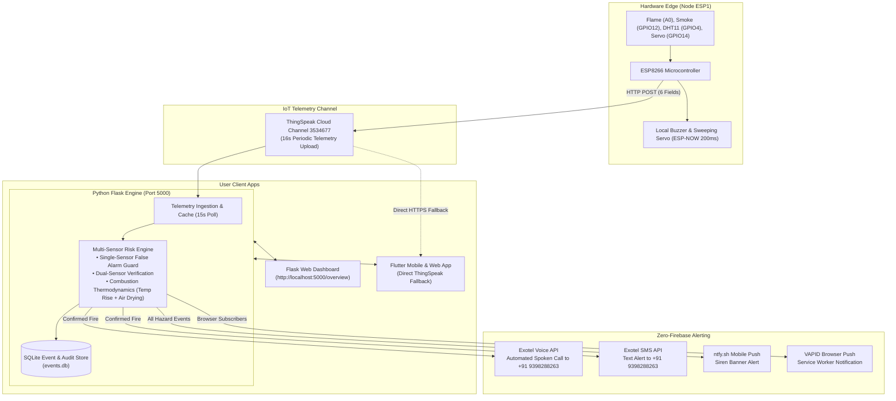

# FireShield AI: Complete Project Master Documentation

**Project Name:** FireShield AI  
**Author / Lead:** Nithin Varma Nampally (`nithinvarmanampally@gmail.com`)  
**Emergency Contact:** `+91 9398288263`  
**System Scope:** Autonomous Multi-Sensor IoT Fire Safety, Telemetry Ingestion, Dynamic Risk Engine, and Zero-Firebase Telephony Alert System  
**Repositories:**  
- **Hardware & Backend:** [GitHub: Fire_Safety](https://github.com/Nithin401/Fire_Safety)  
- **Flutter Web & Mobile Application:** [GitHub: FireShieldAI](https://github.com/Nithin401/FireShieldAI)  
**Last Updated:** November 2026  

---

## 1. Executive Summary

**FireShield AI** is an end-to-end intelligent IoT life-safety prototype designed to detect, verify, and escalate structure fires while systematically suppressing costly and disruptive false alarms. 

Traditional fire alarms rely on single-point threshold detection (e.g. optical infrared detection or ionisation chambers) which trigger false positives from sunlight reflections, aerosol sprays, or room dust. FireShield AI solves this by deploying:
1. **Edge Telemetry:** An ESP8266 transmitter running local safety loops (servo scanner, flame sensor, smoke sensor, DHT11) uploading to ThingSpeak every 16 seconds and transmitting locally via ESP-NOW every 200 ms.
2. **Multi-Sensor Environmental Physics Engine:** A Python Flask backend that learns a room-specific baseline and validates fires using **thermodynamic combustion signatures** (rapid temperature rise coupled with rapid air-drying/humidity loss) or **dual-sensor coincidence** (simultaneous flame + smoke).
3. **Zero-Firebase Alert Infrastructure:** Outbound automated spoken telephone calls and SMS messages powered by **Exotel** directly to the user's Indian mobile number (`+91 9398288263`), paired with background push notifications via **ntfy** and **VAPID Web Push**.
4. **Resilient Cross-Platform Frontend:** A Flutter application and Flask web dashboard with real-time telemetry, direct ThingSpeak HTTPS fallback, and emergency dialing controls.



---

## 2. Hardware Contract & Telemetry Schema

### 2.1 Hardware Specifications (Node ESP1 - Living Room)
* **Microcontroller:** ESP8266 (NodeMCU / Wemos D1 Mini variant)
* **Flame Sensor:** Analog output connected to `A0`
  * Active threshold: `flameValue < 600` (lower raw analog value indicates optical flame detection)
* **Smoke Sensor (MQ series):** Digital output connected to `GPIO12`
  * Active polarity: `LOW` (Active Low: `0` indicates smoke detected, inverted in firmware to `1`)
* **Temperature & Humidity Sensor:** DHT11 connected to `GPIO4`
* **Directional Scanner:** Micro-servo connected to `GPIO14` (scanning 0° to 180° sweeps)
* **Transmitter Timings:**
  * Sensor sampling interval: 2 seconds
  * Servo movement interval: 80 ms
  * ESP-NOW mesh packet interval: 200 ms (survives total Wi-Fi loss)
  * ThingSpeak cloud update interval: 16 seconds

### 2.2 ThingSpeak 6-Field Telemetry Contract
The ThingSpeak Channel (`3534677`) preserves a strict 6-field mapping:

| Field | Parameter | Data Type | Units / Range | Engineering Meaning |
| :--- | :--- | :--- | :--- | :--- |
| `field1` | `FLAME` | Float / Int | `0 - 1024` | Raw analog flame reading (`< 600` = Flame present) |
| `field2` | `SMOKEVALUE` | Integer | `0` or `1` | `1` = Smoke detected, `0` = Clean air |
| `field3` | `TEMPERATURE` | Float | °C (`-20` to `80`) | Ambient air temperature |
| `field4` | `HUMIDITY` | Float | % (`0` to `100`) | Relative air humidity |
| `field5` | `SERVO ANGLE` | Integer | Degrees (`0` to `180`)| Azimuth bearing of scanner head |
| `field6` | `FIRE STATUS` | Integer | `0` or `1` | Hardware rule trigger (`1` = Local alarm active) |

> [!IMPORTANT]
> This contract is immutable across firmware, Flask backend, and Flutter clients to ensure zero protocol drift.

---

## 3. Multi-Sensor Risk Evaluation & False-Alarm Suppression

Single optical or smoke sensors frequently produce false positives caused by direct sunlight reflections, incandescent lighting, vape aerosols, or ambient dust. FireShield AI implements a **3-sensor physical validation engine** in [`services/risk_engine.py`](file:///d:/StartUp/Fire_Safety/fireshield-flask/services/risk_engine.py).

### 3.1 Thermodynamic Combustion Physics
Real combustion causes distinct thermodynamic signatures:
1. **Rapid Temperature Rise:** Combustion releases exothermic convective heat ($\ge 1.5^\circ\text{C/min}$ or net $\Delta T \ge 2.0^\circ\text{C}$).
2. **Air Moisture Depletion (Combustion Drying):** Intense localized thermal heat drops relative humidity drastically below the room's normal statistical baseline ($\mu_{hum} - 1.0\sigma$ or absolute humidity $< 35\%$).

### 3.2 Decision State Machine
The risk engine classifies each telemetry reading into one of seven distinct operational states:

| Risk State | Sensor Conditions | Environmental Thermodynamics | Outbound Voice Call & SMS Action | Dashboard UI Treatment |
| :--- | :--- | :--- | :--- | :--- |
| `NORMAL` | Flame $\ge 600$, Smoke $= 0$, Hardware $= 0$ | Temperature and humidity within normal baseline | **IDLE** (No dispatch) | 🟢 Green Online Badge |
| `SINGLE_SENSOR_SUSPECT` | Flame $< 600$ **OR** Smoke $= 1$ (Only 1 active) | Temperature normal, no rapid drying | **WITHHELD (False Alarm Guard)** | ⚠️ Amber Warning: *"Suspected False Alarm"* |
| `DUAL_SENSOR_ALERT` | Flame $< 600$ **AND** Smoke $= 1$ (Both active) | Any | **IMMEDIATE DISPATCH** (Confidence: 85-95%) | 🚨 Red Danger: *"Dual-Sensor Fire Alert"* |
| `CONFIRMED_FIRE_ALERT` | Any sensor active or Hardware $= 1$ | Temp rising $\ge 1.5^\circ\text{C/min}$ **AND** Humidity dropping | **IMMEDIATE DISPATCH** (Confidence: 95-100%) | 🚨 Red Danger: *"Confirmed Multi-Sensor Fire"* |
| `EARLY_WARNING` | No optical/smoke trigger | Abnormal rate of temperature rise ($\ge 1.5^\circ\text{C/min}$) | **PUSH NOTIFICATION ONLY** (No voice call) | 🟠 Orange Warning: *"Rapid Heat Spike"* |
| `BASELINE_ANOMALY` | No optical/smoke trigger | Temp or humidity deviates $> 2.5\sigma$ from mean | **AUDIT LOG ONLY** | 🔵 Blue Notice: *"Room Baseline Drift"* |
| `SENSOR_OR_DATA_FAULT` | Data stale ($> 60$s) or impossible range | Values out of physical range ($T > 100^\circ\text{C}$) | **FAULT LOGGED** | ⚪ Grey Muted: *"Sensor/Data Fault"* |

---

## 4. Telephony & Emergency Voice Alerting Architecture

To completely eliminate Firebase Cloud Messaging and provide mission-critical alerting, FireShield AI integrates with **Exotel**, India's enterprise cloud telephony infrastructure.

### 4.1 Telephony Pipeline
```
[ Confirmed Fire Detected ]
            │
            ▼
[ Cooldown Guard (300s window) ]
            │
            ├─► Outbound REST Call (POST /v1/Accounts/{SID}/Calls/connect.json)
            │         │
            │         ▼
            │   [ Exotel Telecom Switch ] ──► Cellular GSM Ring to +91 9398288263
            │         │
            │         ▼
            │   [ User Answers Call ] ──► Dynamic ExoML Webhook (/api/voice/exoml)
            │         │
            │         ▼
            │   [ Spoken Indian English Text-to-Speech Alert Delivered ]
            │
            ├─► Parallel Emergency SMS (POST /v1/Accounts/{SID}/Sms/send.json)
            │         │
            │         ▼
            │   SMS Text Delivered to +91 9398288263
            │
            └─► Real-Time Webhook Callback (/api/voice/callback)
                      │
                      ▼
                Updates SQLite Call Record (Ringing ➔ In-Progress ➔ Completed)
```

### 4.2 Spoken Emergency Voice Message
When answered, the call plays an automated clear message generated dynamically from verified sensor telemetry:
> *"FireShield AI critical alert. An active fire emergency has been detected for detection node ESP 1 in Living Room. Both flame and smoke detectors are triggered. Temperature is 48.5 degrees Celsius. Relative humidity is 24.2 percent. Scanner azimuth is 90 degrees. Please verify the area safely and take necessary action."*

### 4.3 Inbound Hotline Answering (Incoming Call IVR)
When any user dials the assigned Exotel virtual number, the backend handles the call via `/api/voice/incoming` and speaks real-time system status:
* **Normal Status:** *"Welcome to the FireShield AI Status Hotline. Detection node ESP 1 in Living Room reports all systems normal. Room temperature is 26 degrees Celsius. No smoke or flame detected. Goodbye."*
* **Emergency Status:** *"Attention. This is the FireShield AI Emergency Status Hotline. A critical fire incident is currently in progress at detection node ESP 1 in Living Room. Immediate evacuation or inspection is advised. Goodbye."*

### 4.4 Telephony Safety & Protection
* **Emergency Number Lock:** Dialing public emergency numbers (`100`, `101`, `108`, `112`, `911`) is blocked programmatically at the service layer to prevent accidental nuisance dialing of emergency services during tests.
* **Anti-Nuisance Cooldown:** A 300-second window prevents repetitive phone calls during persistent sensor triggering.
* **Safe Dry-Run Mode:** Controlled by `VOICE_ALERT_DRY_RUN=true`. Allows comprehensive offline functional testing without consuming telecom credits.

---

## 5. Web Dashboard & Flutter Mobile Application

### 5.1 Python Flask Web Dashboard ([`routes/dashboard.py`](file:///d:/StartUp/Fire_Safety/fireshield-flask/routes/dashboard.py))
* **URL:** `http://localhost:5000/overview` (Local PC) or `http://192.168.29.2:5000/overview` (Mobile on same Wi-Fi)
* **Key Components:**
  * Live 6-gauge sensor telemetry display (Flame, Smoke, Temp, Humidity, Servo, Fire Rule)
  * Real-time Multi-Sensor Risk Evaluation card with confidence score and air drying indicator
  * **Emergency Voice Calling Card:**
    * Live call status badge (`IDLE`, `RINGING`, `IN-PROGRESS`, `COMPLETED`, `COOLDOWN`)
    * **`🚨 Call Now`** button for instant manual operator dispatch
    * **`⏹️ End Call`** button for immediate call termination
    * **`✏️ Update Emergency Contact`** button with persistence to SQLite and `.env`
  * Persistent event and voice call audit log tables backed by SQLite

### 5.2 Flutter Mobile & Web Application ([`_external_FireShieldAI/`](file:///d:/StartUp/Fire_Safety/_external_FireShieldAI/))
* **Automatic ThingSpeak HTTPS Fallback:**
  * In [`FlaskDeviceRepository`](file:///d:/StartUp/Fire_Safety/_external_FireShieldAI/lib/data/repositories/flask_device_repository.dart), if the Flask backend is unreachable (e.g. computer is off or user is on mobile carrier network), the app automatically polls `https://api.thingspeak.com/channels/3534677/feeds/last.json?api_key=KGGT6DMKNSCA6FS6`.
  * **Result:** Real telemetry from Node ESP1 is guaranteed to display continuously on the user's phone.
* **Flutter Emergency Voice Calling Card:**
  * Embedded in [`dashboard_screen.dart`](file:///d:/StartUp/Fire_Safety/_external_FireShieldAI/lib/presentation/features/dashboard/dashboard_screen.dart).
  * Direct one-click trigger of Exotel automated calls to `+91 9398288263` with fallback to native Android phone dialer (`tel:+919398288263`).
  * Direct SMS dispatch and live status polling.

---

## 6. Security, Secrets & Zero-Firebase Architecture

To satisfy strict project constraints, FireShield AI operates completely independently of Firebase Cloud Messaging, Firebase Authentication, or Firestore:

```
[ Private Secrets (.env) ] ──► Loaded at Runtime via dotenv
             │
             ├──► Never checked into Git (.gitignore protected)
             ├──► Never printed in terminal or transcripts
             ├──► Never returned to client browsers (Redacted as "+91****8263")
             └──► Local SQLite database stores persistent contact overrides
```

### Active Configuration Variables (`fireshield-flask/.env`):
```env
# 1. IoT Telemetry Settings
THINGSPEAK_CHANNEL_ID=3534677
THINGSPEAK_READ_API_KEY=KGGT6DMKNSCA6FS6
THINGSPEAK_BASE_URL=https://api.thingspeak.com

# 2. Flask Application Settings
FLASK_SECRET_KEY=fireshield_secret_key_local_dev_2026
FLASK_HOST=0.0.0.0
FLASK_PORT=5000
FLASK_DEBUG=false

# 3. Cache & Freshness Settings
POLL_INTERVAL_SECONDS=15
MAX_HISTORY_RESULTS=500
CACHE_TTL_SECONDS=15
STALE_THRESHOLD_SECONDS=60

# 4. Emergency Contacts
FIRESHIELD_ALERT_PHONE=+919398288263
VAPID_CONTACT_EMAIL=nithinvarmanampally@gmail.com

# 5. Exotel Telephony Credentials
EXOTEL_ACCOUNT_SID=your_account_sid
EXOTEL_API_KEY=your_api_key
EXOTEL_API_TOKEN=your_api_token
EXOTEL_CALLER_ID=your_exotel_virtual_number
VOICE_ALERT_ENABLED=true
VOICE_ALERT_DRY_RUN=false
VOICE_ALERT_COOLDOWN_SECONDS=300
```

---

## 7. Quality Assurance & Test Verification

The application maintains a 100% automated test pass rate across the test suite:

```text
============================= test session starts =============================
platform win32 -- Python 3.10.9, pytest-9.1.1, pluggy-1.6.0
rootdir: D:\StartUp\Fire_Safety
configfile: pytest.ini
collected 63 items

tests\test_api.py ....                                                   [  6%]
tests\test_baseline.py ...                                               [ 11%]
tests\test_data_export.py ...                                            [ 15%]
tests\test_ml_service.py ...                                             [ 20%]
tests\test_notifications.py .........                                    [ 34%]
tests\test_risk_engine.py ...........                                    [ 52%]
tests\test_thingspeak.py .....                                           [ 60%]
tests\test_voice_service.py .........................                    [100%]

============================= 63 passed in 4.04s ==============================
```

### Key Verified Invariants:
1. `test_single_sensor_trigger_does_not_dispatch_voice_call`: Single-sensor optical or smoke glitches never trigger phone calls.
2. `test_hardware_fire_reading_triggers_voice_call`: Simultaneous flame + smoke or verified thermal drying triggers voice and SMS alerts.
3. `test_prohibited_emergency_numbers`: Prevents dialing public emergency numbers.
4. `test_number_normalization`: Normalizes 10-digit Indian numbers to E.164 (`+919398288263`).
5. `test_emergency_contact_update_and_persistence`: Ensures contact edits survive server restarts.
6. `test_incoming_call_handling_normal_and_emergency`: Verifies inbound IVR returns valid ExoML XML speech.
7. `test_terminate_call_endpoint`: Verifies ongoing call termination.

---

## 8. Operational Runbook

### How to Run the Backend
```powershell
cd d:\StartUp\Fire_Safety\fireshield-flask
python app.py
```
* **Dashboard Access:** [http://localhost:5000/overview](http://localhost:5000/overview)
* **Voice Alerts Center:** [http://localhost:5000/voice-alerts](http://localhost:5000/voice-alerts)
* **Mobile Network Access (Same Wi-Fi):** `http://192.168.29.2:5000/overview`

### How to Run or Build the Flutter App
```powershell
# Run locally on Chrome:
cd d:\StartUp\Fire_Safety\_external_FireShieldAI
flutter run -d chrome

# Build Release APK for Android phone:
flutter build apk --release
# APK Output: build/app/outputs/flutter-apk/app-release.apk
```

### How to Test Live Alerts Safely:
1. Visit [http://localhost:5000/overview](http://localhost:5000/overview).
2. Locate the **Emergency Voice Calling** card.
3. Click **`🚨 Call Now`**.
4. Your verified phone (`+91 9398288263`) will ring with the spoken voice alert, and an emergency SMS will arrive simultaneously.
5. Click **`⏹️ End Call`** to test termination.
